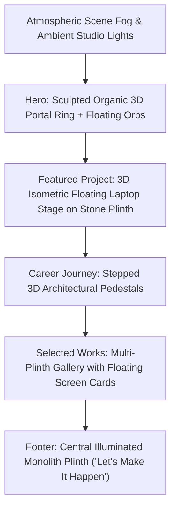
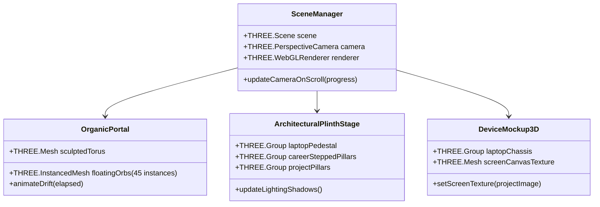

# 🏛️ 3D Organic World & Architectural Plinth Portfolio Master Plan

> **Project:** `nikhilalakri.tech`  
> **Author:** Nikhil Alakri  
> **Inspiration:** Organic Surrealism & Architectural Plinth Design (Soft moss/clay tones, sculpted portal torus, floating orbs, stone plinths, and 3D device staging)  
> **Target Framework:** Next.js 15 (App Router), Three.js, GSAP ScrollTrigger, Lenis Smooth Scroll, TypeScript, Tailwind CSS

---

## 1. Vision & Visual Language

### Aesthetic Pillars
1. **Organic Sculptural Geometry**: Soft, clay-like matte surfaces, rounded pebbles, floating ambient spheres, and an organic toroidal archway framing the hero.
2. **Architectural Plinths & Pedestals**: Fluted classical and minimalist stone pillars that physically elevate projects and career achievements in 3D space.
3. **Atmospheric Lighting & Volumetric Depth**: Directional sun/keylight casting soft contact shadows, depth fog (`fogExp2`), and gentle floating dust motes.
4. **Cohesive Color Calibration**: 
   - Deep canvas background: `#113946` / deep atmospheric jade
   - Warm ivory highlights: `#FFF2D8`
   - Ceramic / moss / brass clay textures: `#a8c1cb`, `#5eead4`, `#cbb594`
   - Preserves **WCAG AA (>4.5:1)** contrast for all typography and UI text.

---

## 2. Technical 3D Architecture

Instead of downloading 50MB+ of slow-loading 3D meshes that harm SEO and Core Web Vitals, the entire organic world is generated **procedurally and with GPU instancing**:

### Key Performance Guarantees:
- **`THREE.InstancedMesh`**: All 40+ floating organic spheres and pebbles share a **single draw call**.
- **Dynamic Canvas Texture**: The 3D laptop screen displays interactive canvas or high-res WebP project snapshots rendered with zero extra DOM elements.
- **IntersectionObserver Render Pausing**: If the 3D scene is covered or minimized, the render loop drops to 0% CPU.
- **SSR & LCP Zero-Penalty**: Loaded asynchronously via `next/dynamic` with `ssr: false`, keeping first load JS under 180 kB.

---

## 3. Section-by-Section 3D Choreography

| Section | 3D Visual Element | Camera & Interaction Behavior |
|---|---|---|
| **01. Hero** | **The Organic Ring Portal & Floating Orbs** | Camera looks through the sculpted organic clay ring. Floating orbs drift organically around Nikhil's editorial title and role. Cursor position subtly deflects floating orbs. |
| **02. Marquee** | **Atmospheric Depth Transition** | Camera descends slightly; floating pebbles pass by the camera with parallax depth. |
| **03. Featured Healthcare Project** | **3D Floating Laptop on Stone Slab** | Camera glides to an isometric 3D view of a floating stone plinth holding a sleek angled laptop showing the **CitiusTech Healthcare UI Platform / Lit Components**. Mouse hover tilts the laptop in 3D. |
| **04. Engineering Pillars & Career** | **Stepped 3D Pedestals** | 5 architectural pillars of varying heights represent 2018 → 2024 career growth. As user hovers each year, that pillar gently illuminates. |
| **05. Selected Works Gallery** | **Twin Plinth Display** | Twin stone pedestals holding interactive floating screen slabs for **odin-eye** and **Tryy.in**. |
| **06. Let's Connect Footer** | **The Illuminated Monolith** | A single illuminated central pedestal glowing under a warm spotlight ("Let's Make It Happen") with call-to-action cards. |

---

## 4. Implementation Milestones

### Phase 1: Procedural Geometries & Shaders
- [ ] Create `components/three/Organic3DWorld.tsx` with scene, fog, and soft ambient lighting.
- [ ] Implement `ProceduralPortal.ts` (noise-displaced organic torus geometry + matte ceramic PBR material).
- [ ] Implement `FloatingOrbs.ts` using `InstancedMesh` with subtle spring physics and cursor repulsion.

### Phase 2: Architectural Plinths & Device Staging
- [ ] Implement `StonePlinth.ts` (fluted pillar and slab geometry with soft beveling).
- [ ] Implement `LaptopStage3D.ts` (isometric 3D laptop with dynamic canvas screen texture).
- [ ] Add stepped career pedestals synchronized with the experience timeline.

### Phase 3: Scroll Synchronization & Camera Path
- [ ] Bind camera position and orientation to Lenis scroll progress via GSAP timeline.
- [ ] Tune camera spline path to seamlessly frame each section without blocking HTML text readability.

### Phase 4: Polish, Accessibility & Lighthouse Audit
- [ ] Verify `prefers-reduced-motion` provides a clean fallback.
- [ ] Audit contrast ratios, keyboard navigation, and ensure 100/100 Lighthouse score is maintained.

